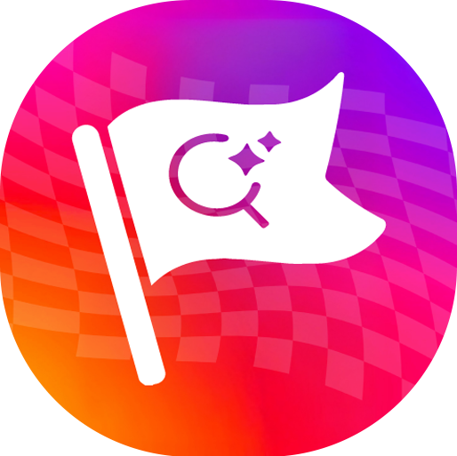
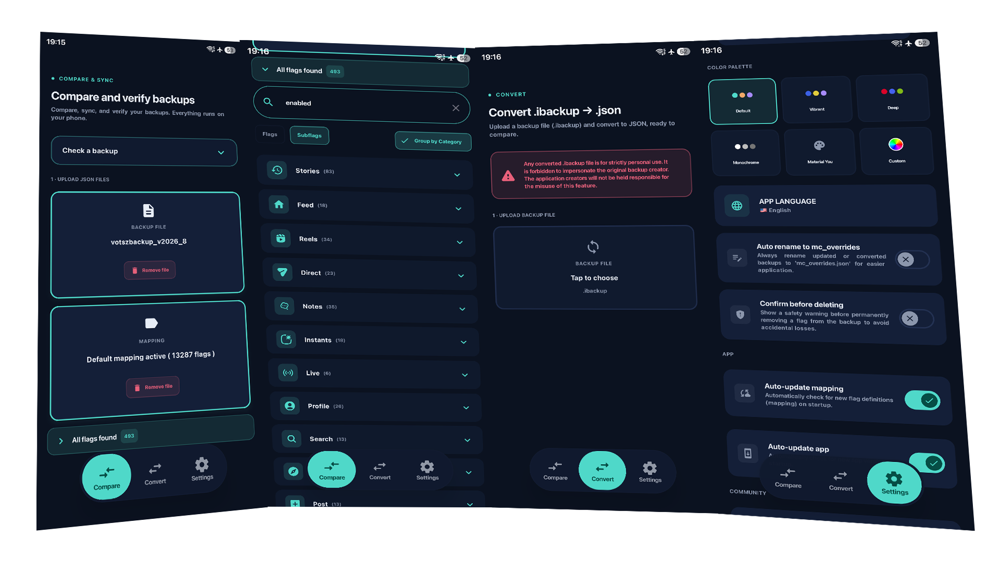

  

<h1 align="center">Flag Sync</h1>

  <strong>Flag Sync</strong> is a high-performance utility designed for advanced users who need to manipulate configuration backups (such as Instagram's) with precision, speed, and style.

---

## 🚀 Key Features

### 1. Advanced Comparison & Sync
- **Operating Modes**:
    - **Compare Backups**: Instant delta identification between two files with real-time syncing.
    - **Double Check**: Side-by-side management of two independent backups.
    - **Single Check**: Dedicated mode for auditing, cleaning, and editing a single file.

### 2. Smart Categorization
- **Category Organization**: Automatically group and organize flags into specific areas (Reels, Stories, Meta IA, Direct, etc.) with custom icons and color-coded headers for easy navigation.

### 3. Personalization & Style
- **Flexible Appearance**: Support for light and dark modes, including a dedicated AMOLED mode. Users can choose from multiple color palettes or define their own identity using a professional color picker.
- **Multi-language Support**: The interface is fully translated into English, Portuguese, and Spanish.

---

## 🛠️ Technology Stack
- **Jetpack Compose**: Modern declarative UI for a fluid and highly reactive user experience.
- **Material 3 & Material You**: Full support for dynamic color themes that adapt automatically to the user's wallpaper.

---

## ⚖️ Legal Disclaimer
The use of this application for converting and modifying system files is the user's strictly personal responsibility. The developers are not responsible for the misuse of backup modification tools or the violation of third-party application terms of service. Use for research and study purposes only.

---

Developed using Claude & Gemini
